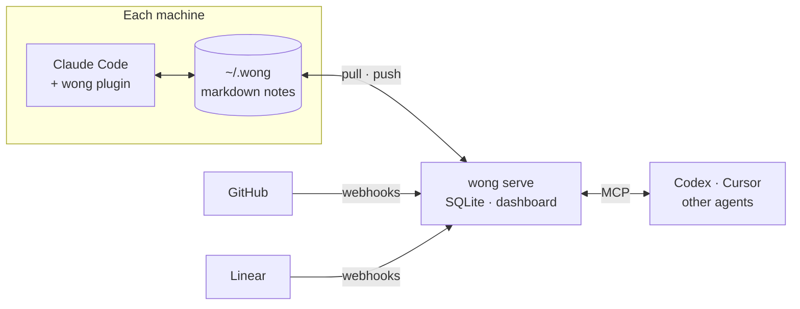

<p align="center">
  <picture>
    <source media="(prefers-color-scheme: dark)" srcset=".github/assets/logo-dark.svg">
    
  </picture>
</p>

<h1 align="center">wong</h1>

<p align="center">
  <strong>An external brain for coding agents.</strong><br>
  Memory, preferences and skills on your own server, with a copy on every machine,<br>
  and every note checked against the code, commits and issues it cites.
</p>

<p align="center">
  <a href="LICENSE"></a>
  
  
  
</p>

<p align="center">
  <a href="#install">Install</a> ·
  <a href="#how-it-works">How it works</a> ·
  <a href="#the-server">Server</a> ·
  <a href="#obsidian">Obsidian</a> ·
  <a href="#commands">Commands</a>
</p>

<picture>
  <source media="(prefers-color-scheme: dark)" srcset=".github/assets/graph-dark.png">
  
</picture>

## Why

Claude Code keeps its memory in one folder per path, and that memory rots:

- **It is split.** A product made of several repos ends up with several memories. What
  the agent learned in one repo, the next one never sees, and your other machine has
  nothing.
- **It goes stale.** Notes copy state that lives somewhere else ("not deployed yet",
  "ENG-15 is in progress"). A month later they swear an issue is open that closed weeks
  ago, or cite a file that moved.
- **It is scattered.** Skills end up in `~/.claude/skills`, `~/.agents/skills` and every
  repo.

Syncing `~/.claude` with git fixes the first point and none of the others. wong keeps the
memory true: each note says what it relies on, wong checks it, and the agents that work on
the project fix what went stale.

The name comes from Wong, the librarian of Kamar-Taj.

## How it works



- **One brain.** It is a folder of markdown notes. `me/` holds what applies everywhere,
  and `projects/<id>/` holds each project, shared by all of its repos. Claude Code reads
  and writes it directly, and you can always export it as plain markdown.
- **Checked against its sources.** `wong check` finds notes that:
  - cite a file that was deleted;
  - call an issue open that is closed;
  - cite a commit that is on no remote branch;
  - link to a note that does not exist;
  - leave work for a deploy that has already happened.
- **Kept by the agents.** wong never calls a model. The plugin brings the outdated notes
  into each session, and the agent fixes them with the `maintain-brain` skill.
- **There when it matters.** When an agent opens a file, it sees the notes that cite that
  file. When it saves a note, wong tells it what the note is missing.
- **Your server.** `wong serve` is a single binary with SQLite, or a Docker image. It
  syncs your machines and keeps every version of every note. It also turns GitHub and Linear
  events into tasks, serves a dashboard and speaks MCP.

## What the agent sees

When a session starts in a repo of the `acme` project:

```text
wong: this session's memory is the brain's project "acme" (~/.wong/projects/acme).

Global preferences from the brain; the notes are in ~/.wong/me, read one when it applies:
- [use-uv](use-uv.md) — Use uv for Python, never pip
- [no-commit-trailers](no-commit-trailers.md) — Commits carry no Co-Authored-By or other trailers

wong: notes of this project leave work for a deploy that has happened. Tell the user
about it before you start on their request:
- projects/acme/run-backfill-after-release.md: acme-api released v1.2.0 on 2026-10-20:
  tell the user what this note leaves for the release, do your part, then update the note

wong check: 1 finding says notes of this project's memory contradict their sources. When
you have finished what the user asked, fix them with the wong:maintain-brain skill:
- projects/acme/old-invoice-pdf.md: app/billing/pdf.py deleted or moved in c5fadf0 on
  2026-10-05, after the note was last updated on 2026-09-15
```

When it is about to edit `app/billing/webhooks.py`:

```text
wong: notes of the brain's project "acme" cite app/billing/webhooks.py or its folder.
Read the ones that bear on what you are about to do:
- billing-webhooks (~/.wong/projects/acme/billing-webhooks.md): Stripe webhooks are
  handled in app/billing/webhooks.py
```

When it saves a note the quick way, the way Claude Code writes memory:

```text
wong: projects/acme/stripe-retries.md is saved, but needs this so wong can check it.
Fix it now, in one edit:
- add `kind`: preference, project, person, client, decision or reference
- set `scope: project:acme`
- add a few `tags` for what it is about, reusing those in use: deploy, oncall, billing, …
- projects/acme/billing-webhooks.md (Stripe webhooks are handled in
  app/billing/webhooks.py) seems to cover the same subject: if it does, add what is new
  to it and delete this one
- declare what it cites in `sources`, so wong notices when it changes: linear:ENG-15,
  file:acme-api/app/billing/webhooks.py
```

## Notes

A note is Claude Code's memory format plus a few fields:

```yaml
---
name: move-billing-to-stripe
description: Decided 2026-09-02 to move billing to Stripe; tracked in ENG-15
kind: decision
scope: project:acme
tags: [billing, payments]
sources:
  - linear:ENG-15
  - file:acme-api/app/billing/webhooks.py
verified: 2026-10-27
---

Billing moves to Stripe. Webhooks first, see [[billing-webhooks]].
```

| Field | Meaning |
| --- | --- |
| `kind` | One of `preference`, `project`, `person`, `client`, `decision` or `reference`. |
| `scope` | `global`, which lives in `me/`, or `project:<id>`. |
| `tags` | A few tags. wong refuses a new spelling of a tag already in use. |
| `sources` | What the claims rely on: `linear:<ID>`, `file:<repo>/<path>`, `commit:<repo>@<sha>`, `note:<name>` or a URL. |
| `verified` | When the note was last checked against them, set by `wong note verify`. A source that changes after this date sends the note back to review. |
| `pending` | `release` or `main` when the note leaves work for the next `v*` tag or push to the main branch. Whoever deploys, the user is reminded. |

Notes point to their sources instead of copying their state. Write "tracked in ENG-15",
not "ENG-15 is in progress".

## Install

wong has two parts: the **server**, which keeps the brain and its history, and **wong on
each machine**, which keeps a copy that Claude Code reads and writes. Set up the server
first. It starts empty, and the first machine you connect fills it with its memory.

### 1. The server

On any machine your others can reach, with Docker:

```yaml
# compose.yaml
services:
  wong:
    image: ghcr.io/17tayyy/wong:latest
    restart: unless-stopped
    ports: ["8787:8787"]
    volumes: ["wong-data:/data"]
volumes:
  wong-data:
```

```sh
docker compose up -d
docker compose exec wong /wong serve --new-token laptop   # one token per machine
```

Without Docker, download the binary for your platform from the
[releases](https://github.com/17tayyy/wong/releases) and run
`wong serve --db /var/lib/wong/wong.db` under systemd or any supervisor. It listens on
`:8787`.

### 2. Each machine

Install wong, on macOS or Linux:

```sh
os=$(uname -s | tr A-Z a-z); arch=$(uname -m | sed 's/x86_64/amd64/;s/aarch64/arm64/')
curl -fsSLo wong "https://github.com/17tayyy/wong/releases/latest/download/wong-$os-$arch"
chmod +x wong && sudo mv wong /usr/local/bin/
```

On Windows, download `wong-windows-amd64.exe` from the releases. With Go 1.27 or later,
`go install github.com/17tayyy/wong/cmd/wong@latest` works anywhere.

Then connect the machine and install the Claude Code plugin:

```sh
wong setup http://wong.lan:8787     # paste the token made for this machine
claude plugin marketplace add 17tayyy/wong
claude plugin install wong@wong
```

`wong setup` does five things:

1. Saves the server and this machine's token.
2. Pulls the brain.
3. Imports this machine's Claude Code memory into it.
4. Pushes the result.
5. Points Claude Code at the brain: every repo to its project, every other folder to
   `me/`.

On the first machine the server is empty, so `wong setup` uploads your memory. On the
others it brings the brain down and adds whatever memory that machine had. From then on,
the plugin pulls when a session starts and pushes when it ends.

Repos that share a parent folder become one project (`~/acme/*` becomes `acme`). The
exception is a folder of unrelated repos such as `~/code`, where each repo is its own
project. Run `wong import --dry-run` first to see the grouping, and pass `--map PATH=ID`
to `wong setup` to change it. Nothing in `~/.claude` is changed, and
`wong link --remove` undoes the links.

### Without a server

To try wong on a single machine, skip the server:

```sh
wong import && wong link --all && wong link --global
```

Then install the plugin. `wong setup` connects that machine to a server later.

## The server

Each machine has its own token. `wong serve --tokens` lists them, and
`--revoke-token <name>` revokes a lost machine's. With Docker, prefix these with
`docker compose exec wong /wong`.

A note changed on two machines at once is never overwritten. The server's version goes
to `~/.wong/.wong/conflicts`, and `wong resolve <path> --keep local|server` settles it.

To reach the server from outside your network, put it behind a tunnel or a proxy with a
certificate, or pass `--tls-cert` and `--tls-key`. wong only sends a token over plain
http to an address on your own network.

### Dashboard

Open the server's address in a browser and sign in with a token, for example one made
with `--new-token browser`. You can:

- read and edit notes in place, then rename, move or delete them;
- undo any change, and see what every machine and agent changed;
- browse the brain as a graph, coloured by project, kind or tag.

<picture>
  <source media="(prefers-color-scheme: dark)" srcset=".github/assets/note-dark.png">
  
</picture>

### Webhooks

Webhooks turn changes elsewhere into tasks on the notes they affect. Each task closes by
itself once the fixed note reaches the server.

- **GitHub:** `POST /hooks/github` for push events, with `WONG_GITHUB_SECRET` set on the
  server. A task is left by a push to the default branch that removes a file a note
  cites. A new `v*` tag or a push to the main branch also leaves one on the notes marked
  `pending` for it.
- **Linear:** `POST /hooks/linear` for issue events, with `WONG_LINEAR_SECRET` set. An
  issue that a note cites leaves a task when it is completed or canceled.

With Docker, set the secrets under `environment:` in `compose.yaml`. The plugin records
which GitHub repo belongs to which project. Only `/hooks/*` needs to be reachable from
the internet. To check Linear issues locally with `wong check`, set
`LINEAR_API_KEY` to a personal API key.

### MCP

The server speaks MCP over Streamable HTTP at `/mcp`, with these tools:

`get_context` · `search_notes` · `read_note` · `write_note` · `edit_note` · `verify_note` · `move_note` · `delete_note`

They follow the same rules as the skill, and every change is signed with the token that
made it.

```sh
codex mcp add wong -- wong mcp     # stdio, through this machine's token
```

Clients that speak HTTP can use `<server>/mcp` directly with a token of their own.

## Obsidian

`~/.wong` opens as an Obsidian vault. Links resolve the same way for Obsidian and for
agents, and Obsidian's own settings stay on each machine.

```sh
wong obsidian export ~/vaults/brain                       # copy the brain into a new vault
wong obsidian import ~/vaults/notes --to acme --dry-run   # bring a vault's notes in
```

## Commands

<details>
<summary>Every command, in one table</summary>

| Command | What it does |
| --- | --- |
| `wong setup` | Connect a machine to the server, bring its memory in and point Claude Code at the brain |
| `wong import` | Bring Claude Code's memory folders into the brain |
| `wong link` | Make Claude Code keep its memory in the brain |
| `wong check` | Check every note against what it cites |
| `wong note show/search/write/verify/move/remove` | Read and write notes the way agents should |
| `wong tags` | List the tags in use |
| `wong tidy` | List duplicate preferences, notes in the wrong folder and notes that grow by additions |
| `wong skills save` | Record where your skills come from, and keep the ones that have no source |
| `wong serve` | Run the server |
| `wong remote`, `pull`, `push`, `sync`, `resolve` | Sync with the server |
| `wong tasks` | List the tasks that webhooks left |
| `wong mcp` | Serve the brain over MCP on stdio |
| `wong obsidian export/import` | Move notes between the brain and an Obsidian vault |

</details>

## Privacy

Your brain stays on your machines and your server. wong talks to your server and, when
you give it a key, to Linear, and to nothing else. It never asks for your Claude
credentials or stores them.

Notes about people and clients are personal data. Keep the server private, or behind
HTTPS with tokens.

## Status

Early. The author uses it every day on two machines. Next: a hosted version for those who
would rather not run a server, and teams.

## Contributing

`go test ./...`, `go vet ./...` and `gofmt` before sending a change. Commits read
`type(scope): description`, in lowercase and the imperative, with the reason in the body.

## License

[AGPL-3.0](LICENSE). Running wong for yourself or your team is free; a modified wong
offered as a service must publish its source.
