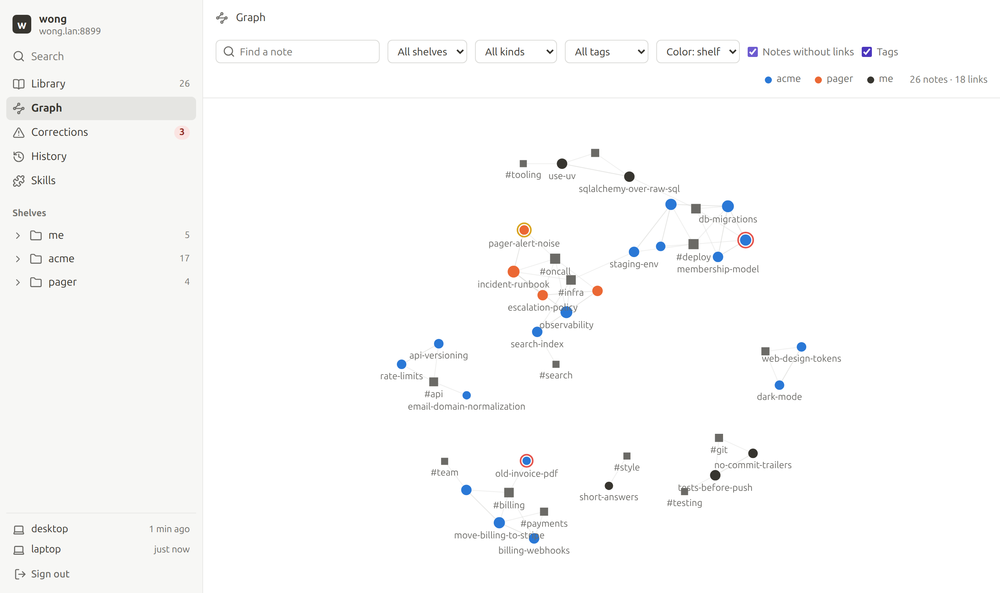
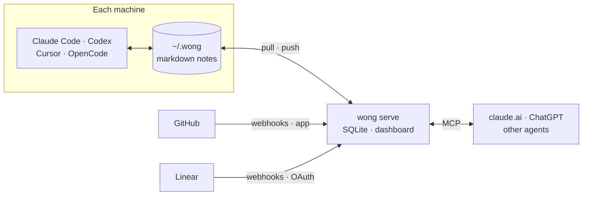
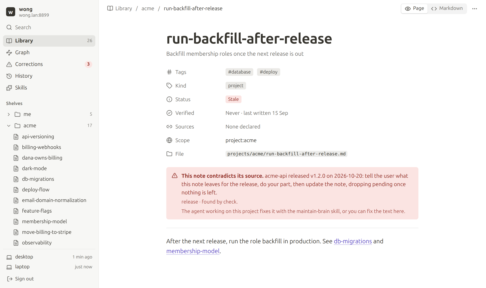

<p align="center">
  <picture>
    <source media="(prefers-color-scheme: dark)" srcset=".github/assets/logo-dark.svg">
    
  </picture>
</p>

<h1 align="center">wong</h1>

<p align="center">
  <strong>An external brain for coding agents.</strong><br>
  Memory, preferences and skills on your own server, with a copy on every machine,<br>
  and every note checked against the code, commits and issues it cites.
</p>

<p align="center">
  <a href="LICENSE"></a>
  
  
  
</p>

<p align="center">
  <a href="#install">Install</a> ·
  <a href="#why">Why</a> ·
  <a href="#how-it-works">How it works</a> ·
  <a href="#the-server">Server</a> ·
  <a href="#obsidian">Obsidian</a> ·
  <a href="#commands">Commands</a>
</p>

<picture>
  <source media="(prefers-color-scheme: dark)" srcset=".github/assets/graph-dark.png">
  
</picture>

## Install

wong has two parts: the **server**, which keeps the brain and its history, and **wong on
each machine**, which keeps a copy that Claude Code reads and writes. The server starts
empty, and the first machine you connect fills it with its memory.

### 1. Start the server

On any machine your others can reach:

```sh
docker run -d --name wong --restart unless-stopped -p 8787:8787 -v wong:/data ghcr.io/17tayyy/wong
docker exec wong /wong serve --new-token browser    # signs you in to the dashboard
```

Open the server's address in a browser and sign in with that token. Machines are let in
from there.

<details>
<summary>With Docker Compose, or without Docker</summary>

```yaml
# compose.yaml
services:
  wong:
    image: ghcr.io/17tayyy/wong:latest
    container_name: wong
    restart: unless-stopped
    ports: ["8787:8787"]
    volumes: ["wong-data:/data"]
volumes:
  wong-data:
```

Without Docker, download the binary for your platform from the
[releases](https://github.com/17tayyy/wong/releases) and run
`wong serve --db /var/lib/wong/wong.db` under systemd or any supervisor.

</details>

### 2. Connect each machine

On macOS or Linux, one line, with your server's address, or wong cloud's,
`https://wong-app.bytay.dev`, if you were invited to it and run no server:

```sh
curl -fsSL https://wong.bytay.dev/install.sh | sh -s -- http://wong.lan:8787
```

The script installs wong and runs `wong setup`, which shows a code. Enter it on the
dashboard's **Connect a machine** page, and the machine gets a token of its own. Then
`wong setup`:

1. Pulls the brain from the server.
2. Imports this machine's Claude Code memory and pushes it.
3. Points Claude Code at the brain: every repo to its project, every other folder to
   `me/`.
4. Sets wong up for the [agents](#agents) on the machine: Claude Code, Codex, Cursor and
   OpenCode.

On the first machine your memory goes up to the empty server. On the others the brain
comes down, and their own memory is added. From then on, wong pulls when a session starts
and pushes when it ends.

<details>
<summary>Windows, and how memory is grouped into projects</summary>

On Windows, download `wong-windows-amd64.exe` from the
[releases](https://github.com/17tayyy/wong/releases), save it as `wong.exe` in a folder
on your PATH, and run `wong setup http://wong.lan:8787`.

Repos that share a parent folder become one project (`~/acme/*` becomes `acme`). A
folder of unrelated repos such as `~/code` is the exception: each repo there is its own
project. `wong import --dry-run` shows the grouping first, and `wong setup --map PATH=ID`
changes it. wong never changes your notes in `~/.claude`; setup only points Claude Code's
settings at the brain, and `wong link --all --remove` and `wong link --global --remove` undo
that.

</details>

### Without a server

To try wong on a single machine, run the script without a url:

```sh
curl -fsSL https://wong.bytay.dev/install.sh | sh
```

`wong setup <url>` connects that machine to a server later. Without one, the brain, the
checks, the notes on each file and `wong precheck` all work; the dashboard (`wong open`),
`wong tasks`, `wong keys` and `wong mcp` need a server.

## Why

Claude Code keeps its memory in one folder per path, and that memory rots:

- **It is split.** A product made of several repos ends up with several memories. What
  the agent learned in one repo, the next one never sees, and your other machine has
  nothing.
- **It goes stale.** Notes copy state that lives somewhere else ("not deployed yet",
  "ENG-15 is in progress"). A month later they swear an issue is open that closed weeks
  ago, or cite a file that moved.
- **It is scattered.** Skills end up in `~/.claude/skills`, `~/.agents/skills` and every
  repo.

Syncing `~/.claude` with git fixes the first point and none of the others. wong keeps the
memory true: each note says what it relies on, wong checks it, and the agents that work on
the project fix what went stale.

The name comes from Wong, the librarian of Kamar-Taj.

## How it works



- **One brain.** It is a folder of markdown notes. `me/` holds what applies everywhere,
  and `projects/<id>/` holds each project, shared by all of its repos. Claude Code reads
  and writes it directly, and you can always export it as plain markdown.
- **Checked against its sources.** `wong check` finds notes that:
  - cite a file that was deleted;
  - call an issue open that is closed;
  - cite a commit that is on no remote branch;
  - link to a note that does not exist;
  - leave work for a deploy that has already happened.
- **Kept by the agents.** wong never calls a model. Its hooks bring the outdated notes
  into each session, and the agent fixes them with the `maintain-brain` skill.
- **There when it matters.** When an agent opens a file, it sees the notes that cite that
  file or apply to it: pitfalls first, and marked when they look outdated. When it saves a
  note, wong tells it what the note is missing. Before a commit, `wong precheck` warns
  about the pitfalls noted on the files it touches.
- **Your server.** `wong serve` is a single binary with SQLite, or a Docker image. It
  syncs your machines and keeps every version of every note. It also turns GitHub and Linear
  events into tasks, serves a dashboard and speaks MCP.
- **Sealed if you want.** With end-to-end encryption the server keeps only what it cannot
  read, and the key lives on your machines.

## Agents

wong works the same way in each of these agents. `wong setup` sets up the ones it finds on
the machine:

| Agent | What wong installs |
| --- | --- |
| Claude Code | The wong plugin: its hooks and the `maintain-brain` skill |
| Codex | The wong plugin, and write access to the brain from Codex's sandbox |
| Cursor | wong's hooks in `~/.cursor/hooks.json` and the skill in `~/.cursor/skills` |
| OpenCode | A plugin in `~/.config/opencode/plugins`, for OpenCode 1 and 2, and the skill |

Each one calls `wong hook` when a session starts, before it reads or edits a file, after
it writes a note and when the session ends. OpenCode can only add to a tool's result, so
there the notes on a file come right after it reads it, and its session ends with each
turn. Codex runs no hook until you trust wong's in Codex with `/hooks`. Other agents
reach the brain over [MCP](#mcp).

## What the agent sees

When a session starts in a repo of the `acme` project:

```text
wong: this session's memory is the brain's project "acme" (~/.wong/projects/acme).

Global preferences from the brain; the notes are in ~/.wong/me, read one when it applies:
- [use-uv](use-uv.md) — Use uv for Python, never pip
- [no-commit-trailers](no-commit-trailers.md) — Commits carry no Co-Authored-By or other trailers

wong: notes of this project leave work for a deploy that has happened. Tell the user
about it before you start on their request:
- projects/acme/run-backfill-after-release.md: acme-api released v1.2.0 on 2026-10-20:
  tell the user what this note leaves for the release, do your part, then update the note

wong check: 1 finding says notes of this project's memory contradict their sources. When
you have finished what the user asked, fix them with the wong:maintain-brain skill:
- projects/acme/old-invoice-pdf.md: app/billing/pdf.py deleted or moved in c5fadf0 on
  2026-10-05, after the note was last updated on 2026-09-15
```

When it is about to edit `app/billing/webhooks.py`:

```text
wong: notes of the brain's project "acme" cite app/billing/webhooks.py or its folder, or
apply to it. Read the ones that bear on what you are about to do:
- stripe-retries (~/.wong/projects/acme/stripe-retries.md), a pitfall: Retrying a failed
  charge without the idempotency key charges twice
- billing-webhooks (~/.wong/projects/acme/billing-webhooks.md): Stripe webhooks are
  handled in app/billing/webhooks.py
  - it contradicts its sources: acme-api/app/billing/events.py deleted or moved in
    c5fadf0 on 2026-10-05, after the note was last updated on 2026-09-15
- webhooks-on-sqs (~/.wong/projects/acme/webhooks-on-sqs.md), superseded by
  billing-webhooks: Webhooks went through SQS
```

When it saves a note the quick way, the way Claude Code writes memory:

```text
wong: projects/acme/stripe-retries.md is saved, but needs this so wong can check it.
Fix it now, in one edit:
- add `kind`: preference, project, person, client, decision, reference or pitfall
- set `scope: project:acme`
- add a few `tags` for what it is about, reusing those in use: deploy, oncall, billing, …
- projects/acme/billing-webhooks.md (Stripe webhooks are handled in
  app/billing/webhooks.py) seems to cover the same subject: if it does, add what is new
  to it and delete this one
- declare what it cites in `sources`, so wong notices when it changes: linear:ENG-15,
  file:acme-api/app/billing/webhooks.py
```

## Notes

A note is Claude Code's memory format plus a few fields:

```yaml
---
name: move-billing-to-stripe
description: Decided 2026-09-02 to move billing to Stripe; tracked in ENG-15
kind: decision
scope: project:acme
tags: [billing, payments]
sources:
  - linear:ENG-15
  - file:acme-api/app/billing/webhooks.py
verified: 2026-10-27
---

Billing moves to Stripe. Webhooks first, see [[billing-webhooks]].
```

| Field | Meaning |
| --- | --- |
| `kind` | One of `preference`, `project`, `person`, `client`, `decision`, `reference` or `pitfall`: what was tried and failed, or what is fragile, in the files it cites. |
| `scope` | `global`, which lives in `me/`, or `project:<id>`. |
| `tags` | A few tags. wong refuses a new spelling of a tag already in use. |
| `sources` | What the claims rely on: `linear:<ID>`, `file:<repo>/<path>`, `commit:<repo>@<sha>`, `note:<name>` or a URL. |
| `verified` | When the note was last checked against them, set by `wong note verify`. A cited issue that closes, or a cited file that is deleted, after this date sends the note back to review. |
| `pending` | `release` or `main` when the note leaves work for the next `v*` tag or push to the main branch. Whoever deploys, the user is reminded. |
| `visibility` | `local` to keep the note on this machine. It never goes to the server. |
| `applies_to` | Globs from a repo's root, such as `app/billing/**` or `*.sql`, for a note that holds for every file there. |
| `supersedes` | The names of the notes a newer decision replaces. They stay for their history, come last when shown and say which note replaced them. |

Notes point to their sources instead of copying their state. Write "tracked in ENG-15",
not "ENG-15 is in progress".

A note that is no longer needed goes to the archive with `wong note archive`: out of the
index, the checks and search, until `wong note unarchive` brings it back. `wong tidy`
proposes the notes to archive, the superseded ones among them.

`wong precheck --install` adds wong to a repo's pre-commit hook: a commit that touches a
file with a pitfall noted on it prints the pitfall, and goes through all the same.

## The server

Each machine has its own token, which it gets when you let it in. `wong serve --tokens`
lists them, and `--revoke-token <name>` revokes a lost machine's. With Docker, run them
as `docker exec wong /wong serve --tokens`. A token piped to `wong setup <url>`, or set in
`WONG_TOKEN` for the install script along with the address, connects a machine without
the dashboard, for scripts. `--new-token` with a name in use replaces that token.

One server can keep a brain for each person or team: `wong serve --accounts <dir>` keeps
each account's brain in a SQLite file of its own, and `--account <id> --new-token browser`
creates an account. Its tokens open that brain alone, in the API, the dashboard and MCP.
`--max-size`, `--max-file` and `--max-requests` bound what each brain may take.

A note changed on two machines at once is never overwritten. The server's version goes
to `~/.wong/.wong/conflicts`, and `wong resolve <path> --keep local|server` settles it.

To reach the server from outside your network, put it behind a tunnel or a proxy with a
certificate, or pass `--tls-cert` and `--tls-key`. wong only sends a token over plain
http to an address on your own network.

`wong move <url>` takes the brain to another server that holds none yet, with its whole
history and, when it is sealed, its key. The old server keeps its copy until you delete
it, and tells your other machines to run `wong setup <url>`.

### End-to-end encryption

A sealed brain is encrypted on your machines before it leaves them. The server keeps
only what it cannot read, file paths included, and the key lives on your machines.

```sh
wong keys seal       # make the key and a recovery code, and encrypt the brain on the server
wong keys approve    # on a machine with the key: let another in, once both show the same code
wong keys recover    # with the recovery code, when no machine with the key is at hand
```

Write the recovery code down. Without it or a machine that holds the key, nobody can open
the brain, the server included. `wong serve --sealed` keeps every brain on a server
sealed: the first machine set up against it seals the brain, and the others wait for a
machine with the key to approve them.

With a sealed brain, `wong open` and `wong mcp` serve the dashboard and MCP from the
machine's own copy, and the machines apply the webhooks' events as they sync. A browser
opens the notes itself once a machine with the key approves it. That works in Chrome,
Edge or Firefox on a computer, and not yet in Safari or on an iPhone or iPad.

AIs that run in the cloud, such as claude.ai, can only reach a sealed brain through the
server. `wong keys cloud-ai on` gives the server the key to open it for them, call by
call, and each one still asks you before it connects. While it is on, the server can read
the brain; `off` makes it forget the key.

### Dashboard

Open the server's address in a browser and sign in with a token, or run `wong open` on a
connected machine to open it signed in. You can:

- read and edit notes in place, then rename, move, archive or delete them;
- undo any change, and see what every machine and agent changed;
- browse the brain as a graph, coloured by project, kind or tag;
- see what is outdated, and on **This week** what changed, what was fixed and what is
  left;
- let machines in, and connect GitHub and Linear;
- see which machines hold the brain's key, and approve the ones that wait for it.

<picture>
  <source media="(prefers-color-scheme: dark)" srcset=".github/assets/note-dark.png">
  
</picture>

### Webhooks

Webhooks turn changes elsewhere into tasks on the notes they affect. Each task closes by
itself once the fixed note reaches the server.

- **GitHub:** push events at `/hooks/github`. A task is left by a push to the default
  branch that removes a file a note cites. A new `v*` tag or a push to the main branch
  also leaves one on the notes marked `pending` for it.
- **Linear:** issue events at `/hooks/linear`. An issue that a note cites leaves a task
  when it is completed or canceled.

The dashboard's **Webhooks** page shows each URL and the events to pick, makes a secret
for GitHub and keeps the one Linear shows. `WONG_GITHUB_SECRET` and `WONG_LINEAR_SECRET`
on the server set them too. With `--accounts`, each account has its own, at
`/hooks/<account>/github` and `/hooks/<account>/linear`. `wong link` records which GitHub
repo belongs to which project. Only `/hooks/*` needs to be reachable from the internet.

**In one click.** Instead of a webhook in every repo, a server can connect GitHub and
Linear from the same page:

- **GitHub App.** `wong github-app --url <server>` makes one in your browser and saves
  its keys to a file; `wong serve --github-app <file>`, or `WONG_GITHUB_APP` set to it,
  takes its webhooks. People install it on their account or organization, pick the
  repos, and sign in with GitHub to show the installation is theirs. Each pull request gets a check named wong: how many notes
  cite files it removes or moves, and how many pitfalls are noted on files it changes,
  never which notes. On a sealed brain the check waits until one of your machines
  answers it: when it next starts an agent session in that project, runs `wong tasks`, or
  has `wong open` running. GitHub sends pushes only to apps that may read code; wong reads
  the lists of files, never what they hold.
- **Linear.** With `WONG_LINEAR_CLIENT_ID` and `WONG_LINEAR_WEBHOOK_SECRET` from a Linear
  OAuth application, **Connect Linear** lets wong read a workspace. The issues that close
  reach the brain, and the machines get a read-only token that renews itself each day,
  kept in the brain's `linear.json`. On a sealed brain the server hands the token to the
  machines sealed for their keys and cannot read it; on a brain in the clear it syncs like
  any other file.

`wong check` reads Linear with that token, or with a personal API key in `LINEAR_API_KEY`.

### MCP

The server speaks MCP over Streamable HTTP at `/mcp`, with these tools:

`get_context` · `search_notes` · `read_note` · `write_note` · `edit_note` · `verify_note` · `move_note` · `archive_note` · `delete_note`

They follow the same rules as the skill, and every change is signed with the token that
made it.

```sh
codex mcp add wong -- wong mcp     # stdio, through this machine's token
```

Clients that speak HTTP can use `<server>/mcp` directly with a token of their own.
Clients that connect with OAuth, such as claude.ai, take the address of `/mcp` and send
you to the dashboard to approve them. Over HTTP, a sealed brain answers only while
`wong keys cloud-ai` is on; `wong mcp`, on a machine with the key, works either way.

## Obsidian

`~/.wong` opens as an Obsidian vault. Links resolve the same way for Obsidian and for
agents, and Obsidian's own settings stay on each machine.

```sh
wong obsidian export ~/vaults/brain                       # copy the brain into a new vault
wong obsidian import ~/vaults/notes --to acme --dry-run   # bring a vault's notes in
```

## Commands

<details>
<summary>Every command, in one table</summary>

| Command | What it does |
| --- | --- |
| `wong setup` | Make the brain this machine's memory, with a server or on its own, and install the plugin |
| `wong import` | Bring Claude Code's memory folders into the brain |
| `wong link` | Make Claude Code keep its memory in the brain |
| `wong check` | Check every note against what it cites |
| `wong precheck` | Warn before a commit about the pitfalls noted on the files it touches |
| `wong note show/search/write/verify/move/archive/unarchive/remove` | Read and write notes the way agents should |
| `wong tags` | List the tags in use |
| `wong tidy` | List duplicate preferences, notes in the wrong folder, notes that grow by additions and notes to archive |
| `wong skills save` | Record where your skills come from, and keep the ones that have no source |
| `wong serve` | Run the server |
| `wong github-app` | Make the GitHub App a server takes pushes and pull requests from |
| `wong remote`, `pull`, `push`, `sync`, `resolve` | Sync with the server |
| `wong keys` | Seal the brain, approve machines, recover the key, let cloud AIs in |
| `wong move` | Take the brain, its history and its key to another server |
| `wong open` | Open the dashboard in a browser, signed in |
| `wong tasks` | List the tasks that webhooks left |
| `wong hook` | What the agents call when a session starts, around a tool and when it ends |
| `wong mcp` | Serve the brain over MCP on stdio |
| `wong obsidian export/import` | Move notes between the brain and an Obsidian vault |

</details>

## Privacy

Your brain stays on your machines and your server, and a sealed one is only readable on
your machines. wong talks to your server and, once you connect it or give it a key, to
Linear; a server with a GitHub App talks to GitHub. Nothing else. It never asks for your
Claude credentials or stores them.

A note that looks like it holds a key or a token stays on the machine, and the push says
where. So does a note marked `visibility: local`.

Notes about people and clients are personal data. Seal the brain, or keep the server
private, or behind HTTPS with tokens.

## Status

1.0: the note format and the sync protocol stay as they are from here on. The author uses
wong every day on two machines. wong cloud, a hosted version where every brain is
end-to-end encrypted, is in beta. Next: teams.

## Contributing

`go test ./...`, `go vet ./...` and `gofmt` before sending a change. Commits read
`type(scope): description`, in lowercase and the imperative, with the reason in the body.

## License

[AGPL-3.0](LICENSE). Running wong for yourself or your team is free; a modified wong
offered as a service must publish its source.
